[English](README.md) · **🌐 العربية** · [עברית](README.he.md)

 

## 👋 نبذة عني

أنا **مطوّر Full-Stack ومهندس أمن سيبراني**، وخريج **هندسة البرمجيات من كلية سامي شمعون للهندسة (SCE)** بتخصص أمن سيبراني و**معدل 90**. أبني تطبيقات آمنة وقابلة للتوسع من البداية إلى النهاية — React Native وأندرويد في الواجهة، و Spring Boot و Node.js و SQL في الخادم.

أعمل اليوم على منتجات موبايل متعددة المنصات في **Dojo** باستخدام React Native و Expo و Strapi ضمن فريق Agile. يهمّني التصميم النظيف، و CI/CD، وبرمجيات تصمد في بيئة الإنتاج.

<table>
<tr><td>🎓 <b>التعليم</b></td><td>بكالوريوس هندسة برمجيات، SCE — أمن سيبراني · معدل 90 (2020–2024)</td></tr>
<tr><td>💼 <b>حالياً</b></td><td>مطوّر Full-Stack في <b>Dojo</b> · مدرّب في <b>ALEH</b></td></tr>
<tr><td>📜 <b>شهادة</b></td><td>تطوير Python آمن ومدمج بالذكاء الاصطناعي — تسوفن–تشبيك (2025)</td></tr>
<tr><td>🗣 <b>اللغات</b></td><td>العربية (اللغة الأم) · العبرية (متقدم) · الإنجليزية (متقدم)</td></tr>
<tr><td>📍 <b>الموقع</b></td><td>إسرائيل · متاح للعمل عن بُعد</td></tr>
</table>

## 🧭 ماذا أقدّم

<table>
<tr>
<td width="50%" valign="top">

### 📱 تطبيقات الموبايل
تطبيقات متعددة المنصات بـ **React Native و Expo**، وتطبيقات أندرويد أصلية بـ **Java و Kotlin** — من أول شاشة حتى النشر على Google Play.

</td>
<td width="50%" valign="top">

### 🌐 الويب
واجهات متجاوبة وسهلة الوصول بـ **React و Next.js** مربوطة بـ REST APIs، متعددة اللغات وتدعم RTL.

</td>
</tr>
<tr>
<td width="50%" valign="top">

### ⚙️ الخوادم
خدمات REST بـ **Spring Boot و Node.js و PHP** فوق MySQL و PostgreSQL و MongoDB — نماذج بيانات نظيفة وتوسّع متوقّع.

</td>
<td width="50%" valign="top">

### 🔐 الأمن و DevOps
برمجة آمنة (**OWASP Top 10**) من دراسة الأمن السيبراني، مع **CI/CD على Jenkins و AWS** للنشر بأمان وبشكل متكرر.

</td>
</tr>
</table>

## 🚀 أعمال مختارة

<table>
<tr>
<td width="33%" valign="top" align="center">

 <b>Dojo — Fulfillment Together</b>
 تطبيق موبايل متعدد المنصات، متوفر على Google Play
 <code>React Native</code> <code>Expo</code> <code>Strapi</code>
</td>
<td width="33%" valign="top" align="center">

 <b>Calme</b>
 منصة تشخيص للصحة النفسية بالذكاء الاصطناعي
 <code>React</code> <code>Flask</code> <code>Gemini</code> <code>WebSocket</code>
</td>
<td width="33%" valign="top" align="center">

 <b>Automated SEO Reporting</b>
 منصة تحليل أداء المواقع
 <code>Python</code> <code>React</code> <code>Spring Boot</code>
</td>
</tr>
<tr>
<td width="33%" valign="top" align="center">

 <b>متجر إلكتروني</b>
 متجر متكامل مع الدفع الإلكتروني
 <code>Next.js</code> <code>Strapi</code> <code>Auth0</code> <code>PayPal</code>
</td>
<td width="33%" valign="top" align="center">

 <b>ProjectPulse</b>
 نظام إدارة مشاريع التخرج الجامعية
 <code>React</code> <code>TypeScript</code> <code>Spring Boot</code>
</td>
<td width="33%" valign="top" align="center">

 <b>Babcom Shift</b>
 إدارة ورديات — ويب وموبايل
 <code>Next.js</code> <code>React Native</code> <code>PostgreSQL</code>
</td>
</tr>
</table>

> 📡 **مفتوح المصدر:** [**Universal IR**](https://github.com/abedallaSK/universal-ir) — ريموت عالمي بالأشعة تحت الحمراء و Wi-Fi لأندرويد (مكيفات، تلفزيونات، TV Box، إضاءة). Kotlin · Jetpack Compose · 15 لغة.

<b>مشاريع أخرى (13)</b>

 

| المشروع | النوع | التقنيات |
|---|---|---|
| WorkTimer Pro | تطبيق متعدد المنصات | React Native · Expo |
| Azan for Huawei Watch | تطبيق ساعة ذكية | Watch App Engine · JavaScript |
| Subtitle Overlay | تطبيق موبايل | React Native |
| Cross Clipboard | مزامنة الحافظة بين الأجهزة | Flutter · Dart · Node.js |
| Warehouse Management for Rent | تطبيق ويب متكامل | Java · Spring Boot · React · SQL |
| Azan & Weather | تطبيق ويب | React · Next.js |
| Step Coins | تطبيق أندرويد | Java · PHP |
| Flight Booking | موقع ويب | C# · Firebase |
| [Quick Entry](https://github.com/abedallaSK/Quick_Entry) | تطبيق أندرويد | Java |
| Aqua Frame | تطبيق سطح مكتب | Java |
| Medical Diagnosis | تطبيق سطح مكتب | Java · JavaFX |
| Keylogger | بحث أمني | Python |
| Heartbleed (OpenSSL) | بحث أمني | Python |

شاهد جميع المشاريع مع الصور في [معرض أعمالي](https://abedallask.netlify.app/ar/portfolio).

## 💼 الخبرة العملية

| الفترة | الدور | الجهة |
|---|---|---|
| **أكتوبر 2024 – الآن** | 🥋 **مطوّر Full-Stack** — تطبيقات متعددة المنصات بـ React Native و Expo و Strapi؛ تصميم قواعد MySQL؛ CI/CD والنشر للإنتاج | **Dojo** · عن بُعد |
| **أبريل 2024 – الآن** | 🧑‍🏫 **مدرّب** | **ALEH** |
| سبتمبر – ديسمبر 2024 | 🔎 **محلل SEO (متدرّب)** — بوت Python لأتمتة SEO؛ Google Analytics و Google APIs | **OnePunch** · عن بُعد |
| أغسطس 2023 – فبراير 2024 | 🏆 **مطوّر Full-Stack (متدرّب)** — نظام جوائز لأندرويد بـ Java/Kotlin؛ خدمات PHP على AWS؛ Jenkins CI/CD | **Deqa.io** |

## 🛠 التقنيات

  

  

  

## 📊 GitHub بالأرقام

<picture>
  <source media="(prefers-color-scheme: dark)" srcset="assets/activity-dark.svg" />
  
</picture>

<picture>
  <source media="(prefers-color-scheme: dark)" srcset="assets/languages-dark.svg" />
  
</picture>

تُولَّد هذه البطاقات من بيانات GitHub الحقيقية وتُحدَّث يومياً تلقائياً.

## 📫 لنتواصل

لديك مشروع أو فرصة عمل أو تريد فقط أن تقول مرحباً؟
  

