[English](README.md) · [العربية](README.ar.md) · **🌐 עברית**

 

## 👋 קצת עליי

אני **מפתח Full-Stack ומהנדס סייבר**, **בוגר הנדסת תוכנה במכללה האקדמית להנדסה סמי שמעון (SCE)** בהתמחות סייבר, עם **ממוצע 90**. אני בונה אפליקציות מאובטחות וסקיילביליות מקצה לקצה — React Native ואנדרואיד בצד הלקוח, Spring Boot, Node.js ו-SQL בצד השרת.

היום אני מפתח מוצרי מובייל חוצי פלטפורמות ב-**Dojo**, עם React Native, Expo ו-Strapi בצוות Agile. חשובים לי ארכיטקטורה נקייה, CI/CD ותוכנה שעומדת בעומס של פרודקשן.

<table>
<tr><td>🎓 <b>השכלה</b></td><td>B.Sc. הנדסת תוכנה, SCE — התמחות סייבר · ממוצע 90 (2020–2024)</td></tr>
<tr><td>💼 <b>כיום</b></td><td>מפתח Full-Stack ב-<b>Dojo</b> · מדריך ב-<b>ALEH</b></td></tr>
<tr><td>📜 <b>תעודה</b></td><td>פיתוח Python מאובטח משולב AI — צופן–תשביק (2025)</td></tr>
<tr><td>🗣 <b>שפות</b></td><td>ערבית (שפת אם) · עברית (מתקדם) · אנגלית (מתקדם)</td></tr>
<tr><td>📍 <b>מיקום</b></td><td>ישראל · פתוח לעבודה מרחוק</td></tr>
</table>

## 🧭 מה אני עושה

<table>
<tr>
<td width="50%" valign="top">

### 📱 מובייל
אפליקציות חוצות פלטפורמות ב-**React Native ו-Expo**, ואנדרואיד נייטיב ב-**Java ו-Kotlin** — מהמסך הראשון ועד פרסום ב-Google Play.

</td>
<td width="50%" valign="top">

### 🌐 ווב
ממשקים רספונסיביים ונגישים ב-**React ו-Next.js**, מחוברים ל-REST APIs. רב-לשוניים ותומכי RTL כברירת מחדל.

</td>
</tr>
<tr>
<td width="50%" valign="top">

### ⚙️ צד שרת
שירותי REST ב-**Spring Boot, Node.js ו-PHP** מעל MySQL, PostgreSQL ו-MongoDB — מודלי נתונים נקיים וגדילה צפויה.

</td>
<td width="50%" valign="top">

### 🔐 אבטחה ו-DevOps
קוד מאובטח (**OWASP Top 10**) מהתואר בסייבר, יחד עם **CI/CD על Jenkins ו-AWS** לפריסה בטוחה ותכופה.

</td>
</tr>
</table>

## 🚀 עבודות נבחרות

<table>
<tr>
<td width="33%" valign="top" align="center">

 <b>Dojo — Fulfillment Together</b>
 אפליקציית מובייל חוצת פלטפורמות, זמינה ב-Google Play
 <code>React Native</code> <code>Expo</code> <code>Strapi</code>
</td>
<td width="33%" valign="top" align="center">

 <b>Calme</b>
 פלטפורמת אבחון לבריאות הנפש מבוססת AI
 <code>React</code> <code>Flask</code> <code>Gemini</code> <code>WebSocket</code>
</td>
<td width="33%" valign="top" align="center">

 <b>Automated SEO Reporting</b>
 פלטפורמה לניתוח ביצועי אתרים
 <code>Python</code> <code>React</code> <code>Spring Boot</code>
</td>
</tr>
<tr>
<td width="33%" valign="top" align="center">

 <b>חנות אונליין</b>
 חנות Full-Stack עם תשלומים
 <code>Next.js</code> <code>Strapi</code> <code>Auth0</code> <code>PayPal</code>
</td>
<td width="33%" valign="top" align="center">

 <b>ProjectPulse</b>
 מערכת לניהול פרויקטי גמר באוניברסיטה
 <code>React</code> <code>TypeScript</code> <code>Spring Boot</code>
</td>
<td width="33%" valign="top" align="center">

 <b>Babcom Shift</b>
 ניהול משמרות — ווב ומובייל
 <code>Next.js</code> <code>React Native</code> <code>PostgreSQL</code>
</td>
</tr>
</table>

> 📡 **קוד פתוח:** [**Universal IR**](https://github.com/abedallaSK/universal-ir) — שלט אוניברסלי באינפרא-אדום וב-Wi-Fi לאנדרואיד (מזגנים, טלוויזיות, סטרימרים, תאורה). Kotlin · Jetpack Compose · 15 שפות.

<b>פרויקטים נוספים (13)</b>

 

| פרויקט | סוג | טכנולוגיות |
|---|---|---|
| WorkTimer Pro | אפליקציה חוצת פלטפורמות | React Native · Expo |
| Azan for Huawei Watch | אפליקציה לשעון חכם | Watch App Engine · JavaScript |
| Subtitle Overlay | אפליקציית מובייל | React Native |
| Cross Clipboard | סנכרון לוח העתקה בין מכשירים | Flutter · Dart · Node.js |
| Warehouse Management for Rent | אפליקציית ווב Full-Stack | Java · Spring Boot · React · SQL |
| Azan & Weather | אפליקציית ווב | React · Next.js |
| Step Coins | אפליקציית אנדרואיד | Java · PHP |
| Flight Booking | אתר | C# · Firebase |
| [Quick Entry](https://github.com/abedallaSK/Quick_Entry) | אפליקציית אנדרואיד | Java |
| Aqua Frame | אפליקציית דסקטופ | Java |
| Medical Diagnosis | אפליקציית דסקטופ | Java · JavaFX |
| Keylogger | מחקר אבטחה | Python |
| Heartbleed (OpenSSL) | מחקר אבטחה | Python |

את כל הפרויקטים עם צילומי מסך אפשר לראות ב[תיק העבודות שלי](https://abedallask.netlify.app/he/portfolio).

## 💼 ניסיון תעסוקתי

| מתי | תפקיד | איפה |
|---|---|---|
| **אוקטובר 2024 – היום** | 🥋 **מפתח Full-Stack** — אפליקציות חוצות פלטפורמות ב-React Native, Expo ו-Strapi; תכנון סכמות MySQL; CI/CD ושחרורים לפרודקשן | **Dojo** · מרחוק |
| **אפריל 2024 – היום** | 🧑‍🏫 **מדריך** | **ALEH** |
| ספטמבר – דצמבר 2024 | 🔎 **מתמחה ניתוח SEO** — בוט Python לאוטומציית SEO; Google Analytics ו-Google APIs | **OnePunch** · מרחוק |
| אוגוסט 2023 – פברואר 2024 | 🏆 **מתמחה פיתוח Full-Stack** — מערכת פרסים לאנדרואיד ב-Java/Kotlin; שירותי PHP על AWS; Jenkins CI/CD | **Deqa.io** |

## 🛠 טכנולוגיות

  

  

  

## 📊 GitHub במספרים

<picture>
  <source media="(prefers-color-scheme: dark)" srcset="assets/activity-dark.svg" />
  
</picture>

<picture>
  <source media="(prefers-color-scheme: dark)" srcset="assets/languages-dark.svg" />
  
</picture>

הכרטיסים נוצרים מנתוני GitHub אמיתיים ומתעדכנים אוטומטית כל יום.

## 📫 בואו נדבר

יש לכם פרויקט, משרה, או סתם רוצים להגיד שלום?
  

