**🌐 English** · [العربية](README.ar.md) · [עברית](README.he.md)

 

## 👋 About me

I'm a **Full-Stack Developer and Cybersecurity Engineer**, and a **Software Engineering graduate of Sami Shamoon College of Engineering (SCE)** with a cybersecurity specialization and a **90 GPA**. I build secure, scalable applications end to end — React Native and Android on the front, Spring Boot, Node.js and SQL on the back.

Today I build cross-platform mobile products at **Dojo**, shipping with React Native, Expo and Strapi in an Agile team. I care about clean architecture, CI/CD, and software that holds up in production.

<table>
<tr>
<td>🎓 <b>Education</b></td><td>BSc Software Engineering, SCE — Cybersecurity · GPA 90 (2020–2024)</td>
</tr>
<tr>
<td>💼 <b>Now</b></td><td>Full-Stack Developer at <b>Dojo</b> · Instructor at <b>ALEH</b></td>
</tr>
<tr>
<td>📜 <b>Certificate</b></td><td>AI-Integrated Secure Python Development — Tsofen–Tashbik (2025)</td>
</tr>
<tr>
<td>🗣 <b>Languages</b></td><td>Arabic (native) · Hebrew (advanced) · English (advanced)</td>
</tr>
<tr>
<td>📍 <b>Based in</b></td><td>Israel · open to remote</td>
</tr>
</table>

## 🧭 What I do

<table>
<tr>
<td width="50%" valign="top">

### 📱 Mobile
Cross-platform apps with **React Native & Expo**, plus native Android in **Java & Kotlin** — from first screen to a release on Google Play.

</td>
<td width="50%" valign="top">

### 🌐 Web
Responsive, accessible interfaces in **React & Next.js**, wired to REST APIs. Multilingual and RTL-ready by default.

</td>
</tr>
<tr>
<td width="50%" valign="top">

### ⚙️ Backend
REST services in **Spring Boot, Node.js and PHP** over MySQL, PostgreSQL and MongoDB — clean data models, predictable scaling.

</td>
<td width="50%" valign="top">

### 🔐 Security & DevOps
Secure coding (**OWASP Top 10**) from a cybersecurity degree, with **CI/CD on Jenkins and AWS** to ship safely and often.

</td>
</tr>
</table>

## 🚀 Featured work

<table>
<tr>
<td width="33%" valign="top" align="center">

 <b>Dojo — Fulfillment Together</b>
 Cross-platform mobile app, live on Google Play
 <code>React Native</code> <code>Expo</code> <code>Strapi</code>
</td>
<td width="33%" valign="top" align="center">

 <b>Calme</b>
 AI mental-health diagnostic platform
 <code>React</code> <code>Flask</code> <code>Gemini</code> <code>WebSocket</code>
</td>
<td width="33%" valign="top" align="center">

 <b>Automated SEO Reporting</b>
 Web performance analysis platform
 <code>Python</code> <code>React</code> <code>Spring Boot</code>
</td>
</tr>
<tr>
<td width="33%" valign="top" align="center">

 <b>E-commerce Store</b>
 Full-stack store with payments
 <code>Next.js</code> <code>Strapi</code> <code>Auth0</code> <code>PayPal</code>
</td>
<td width="33%" valign="top" align="center">

 <b>ProjectPulse</b>
 University final-project management
 <code>React</code> <code>TypeScript</code> <code>Spring Boot</code>
</td>
<td width="33%" valign="top" align="center">

 <b>Babcom Shift</b>
 Shift management — web + mobile
 <code>Next.js</code> <code>React Native</code> <code>PostgreSQL</code>
</td>
</tr>
</table>

> 📡 **Open source:** [**Universal IR**](https://github.com/abedallaSK/universal-ir) — infrared + Wi-Fi universal remote for Android (ACs, TVs, TV boxes, lights). Kotlin · Jetpack Compose · 15 languages.

<b>More projects (13)</b>

 

| Project | Type | Stack |
|---|---|---|
| WorkTimer Pro | Cross-platform app | React Native · Expo |
| Azan for Huawei Watch | Smartwatch app | Watch App Engine · JavaScript |
| Subtitle Overlay | Mobile app | React Native |
| Cross Clipboard | Cross-device clipboard sync | Flutter · Dart · Node.js |
| Warehouse Management for Rent | Full-stack web app | Java · Spring Boot · React · SQL |
| Azan & Weather | Web app | React · Next.js |
| Step Coins | Android app | Java · PHP |
| Flight Booking | Website | C# · Firebase |
| [Quick Entry](https://github.com/abedallaSK/Quick_Entry) | Android app | Java |
| Aqua Frame | Desktop app | Java |
| Medical Diagnosis | Desktop app | Java · JavaFX |
| Keylogger | Security research | Python |
| Heartbleed (OpenSSL) | Security research | Python |

See all of them with screenshots on my [portfolio](https://abedallask.netlify.app/en/portfolio).

## 💼 Experience

| When | Role | Where |
|---|---|---|
| **Oct 2024 – now** | 🥋 **Full-Stack Developer** — cross-platform apps with React Native, Expo & Strapi; MySQL schema design; CI/CD and production releases | **Dojo** · Remote |
| **Apr 2024 – now** | 🧑‍🏫 **Instructor** | **ALEH** |
| Sep – Dec 2024 | 🔎 **SEO Analyst (Intern)** — Python scraping bot for SEO automation; Google Analytics & Google APIs | **OnePunch** · Remote |
| Aug 2023 – Feb 2024 | 🏆 **Full-Stack Developer (Intern)** — Android awards system in Java/Kotlin; PHP services on AWS; Jenkins CI/CD | **Deqa.io** |

## 🛠 Tech stack

  

  

  

## 📊 GitHub in numbers

<picture>
  <source media="(prefers-color-scheme: dark)" srcset="assets/activity-dark.svg" />
  
</picture>

<picture>
  <source media="(prefers-color-scheme: dark)" srcset="assets/languages-dark.svg" />
  
</picture>

Cards are generated from live GitHub data and refreshed daily by <a href=".github/workflows/profile-cards.yml">a GitHub Action</a>.

## 📫 Let's talk

Have a project, a role, or just want to say hello?
  

